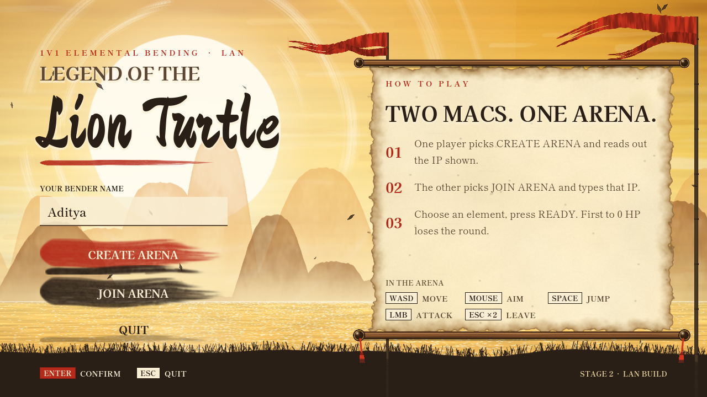
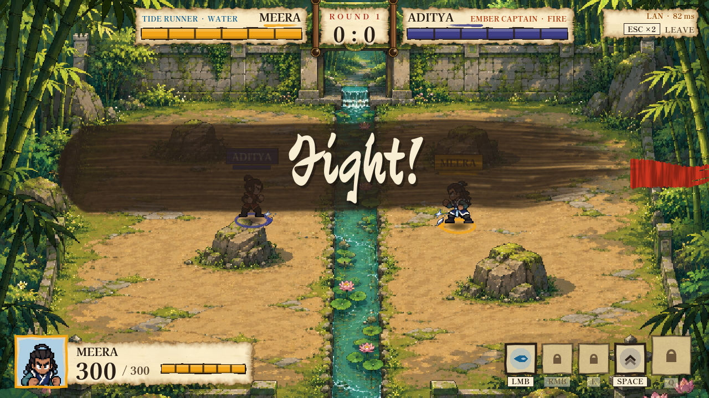
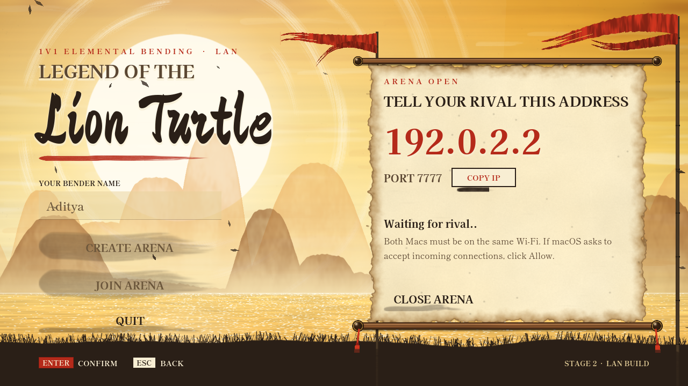
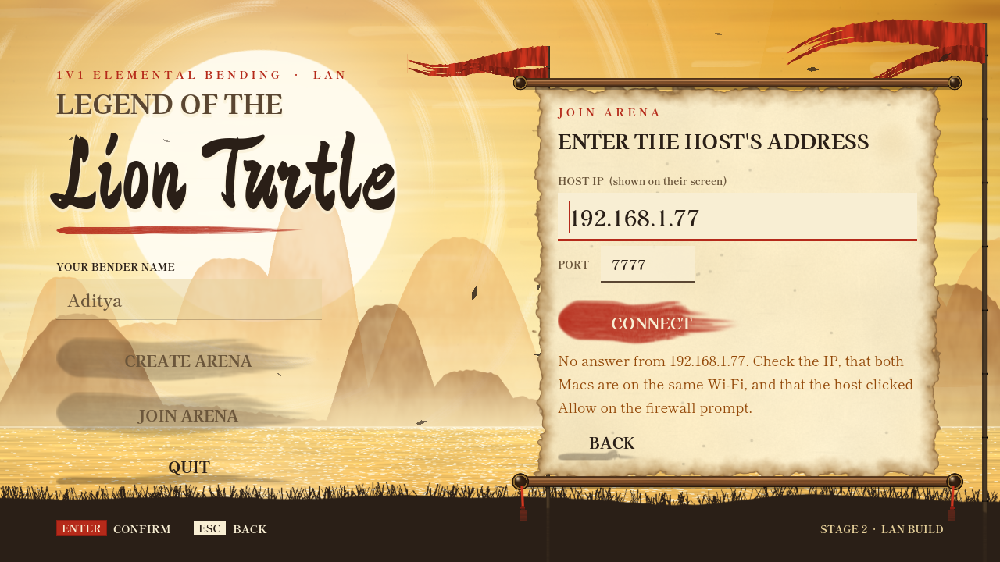
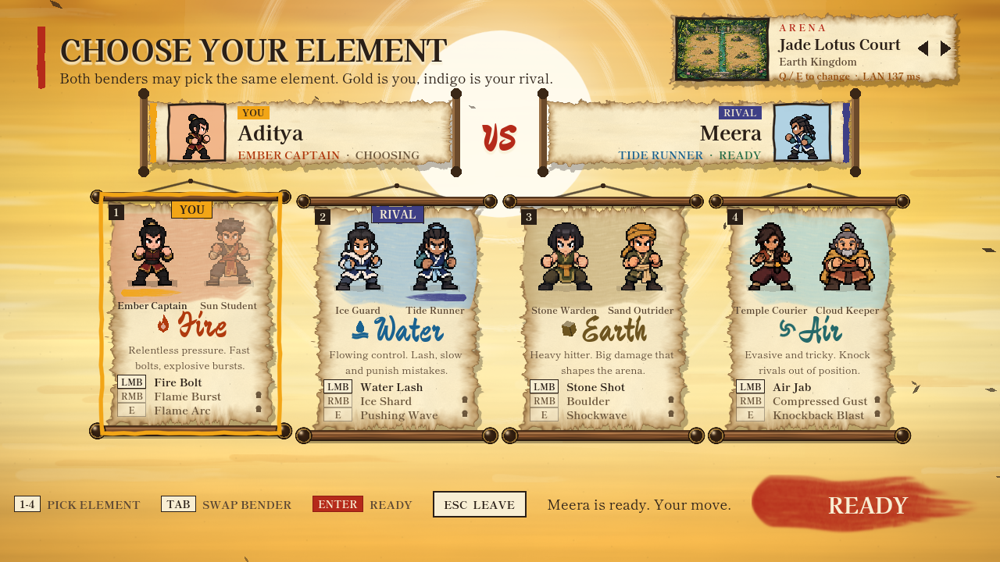
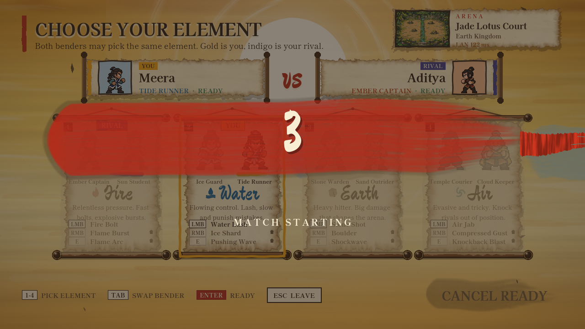
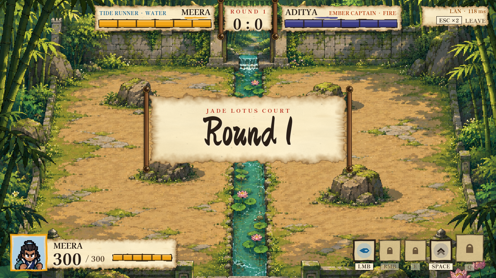
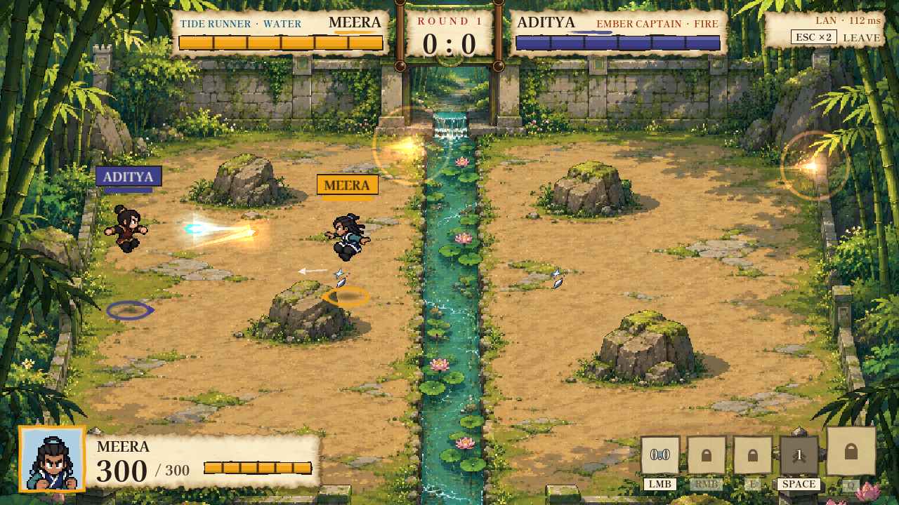
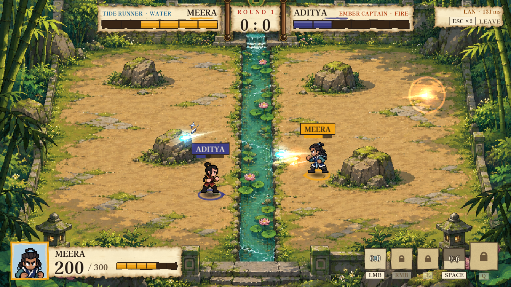
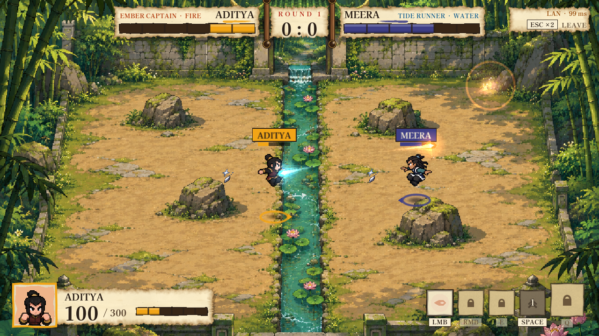

# Scroll & Ink — UI design system

The UI language of **Legend of Lion Turtle**, a 1v1 elemental-bending arena game for two Macs on a LAN. It covers every screen a player touches: main menu, lobby, match HUD, and the big moments between them.

The reference is the painted 2D sequences of Kung Fu Panda 2. Screens are full-bleed paintings in golden-hour light, textured like brushwork on paper. Menus are hanging scrolls on lacquered rods. Red cloth banners stream in the wind, and dark leaves drift across everything. The arena itself is the pixel-art painting from the arena pack, shown full screen with nothing framing it.



## Six principles

1. **Golden air.** Every menu sits in a painted landscape: a dry-brushed sky, a pale sun ringed by brushed halos, karst mountains in ink wash fading into mist, a glittering river, and an ink grass ridge. Nothing is a flat fill.
2. **Paper and ink.** Surfaces are parchment with fibers, mottling, and a torn, burnt edge. Text and frames are ink. Menus are scrolls that unroll when they open.
3. **Brush, not box.** Buttons, bars and banners are dry-brush strokes: a pressed, rounded start, a full body, and bristles that run dry and split at the tail. There are no bevels, no skew, and no gradients except light and wash.
4. **One red.** Vermilion is the call to action: the primary button, seals, banners and VICTORY. Ribbon red is decoration only and never carries text.
5. **Sun vs dusk.** The local player is sun gold and the rival is dusk indigo, whatever their element, so mirror matches stay readable.
6. **The arena is the painting.** In a match the arena art fills the screen edge to edge. The HUD floats on top as paper strips and fades when a fighter walks under it. Character sprites are drawn exactly as supplied. Nothing tints, outlines or flashes them.

## Content fundamentals

- **Actions are verbs in caps:** CREATE ARENA, JOIN ARENA, READY, CONNECT, CLOSE ARENA. Use two words at most.
- **Headers are short statements** in the player's frame: CHOOSE YOUR ELEMENT, TELL YOUR RIVAL THIS ADDRESS.
- **Sentences are sentence case** and say what to do next: "Waiting for Meera to ready up...", "Meera is ready. Your move."
- **Errors name the cause and the fix together:** "No answer from 192.168.1.77. Check the IP, that both Macs are on the same Wi-Fi, and that the host clicked Allow on the firewall prompt."
- **Players are YOU and RIVAL.** Never "enemy", "P1" or "opponent". Names come from the player.
- Use three dots (`...`), not the ellipsis glyph, which the CJK-style fonts draw mid-line.

## Color

All values live in `ui_tokens.gd`.

| Role | Tokens | Rule |
| --- | --- | --- |
| Sky | `SKY_TOP`, `SKY_MID`, `SKY_LOW`, `HAZE`, `SUN` | Backdrop only; painted into `sky.png`, `sun.png`, `water.png`. |
| Paper | `PAPER` f2e2b8, `PAPER_LIGHT`, `PAPER_DARK`, `PAPER_EDGE` | Text goes on `PAPER` or `PAPER_LIGHT`. |
| Ink | `INK` 2a1f17, `INK_SOFT`, `INK_FAINT`, `INK_WASH` | Text, frames, silhouettes. |
| Wood | `WOOD`, `WOOD_LIGHT`, `WOOD_DARK` | Scroll rods, poles. |
| Call to action | `VERMILION` b52a1a, `VERMILION_HOVER`, `VERMILION_DEEP` | Primary button, seals, VICTORY. |
| Decoration | `RIBBON` | Banners and tassels. Never behind text. |
| Sides | `SIDE_YOU` (sun gold), `SIDE_RIVAL` (dusk indigo) | Name tags, ground rings, HP fills, YOU/RIVAL tags. |
| Elements | `ELEMENT`, `ELEMENT_GLOW`, `ELEMENT_WASH` | Text-safe ink, bright light for effects, and a pale wash behind portraits. |
| Feedback | `SUCCESS`, `WARNING`, `DANGER`, `HP_LAG` | States only. |

**Side vs element.** A fighter carries two colors at once. Side (gold or indigo) goes on name tags, ground rings and HP fills. Element goes on emblems, bolts and glows. Never put an element color on a side marker.

**Contrast.**
- Ink on paper is 12.5:1, `INK_SOFT` 6.9:1, and `INK_FAINT` 5.4:1.
- Paper-light text on vermilion is 5.5:1, and on indigo 8:1.
- Use ink text on sun gold (7.8:1).
- Gold is never used for text on paper.

## Typography

Three families, all SIL Open Font License, subset to Latin:

| Role | Font | Used for |
| --- | --- | --- |
| `display` | Zhi Mang Xing | Brush script: *Lion Turtle*, Round 1, Fight!, Victory, the countdown, element names |
| `heading` | Kaisei Tokumin ExtraBold | Titles, headers, buttons |
| `body`, `body_strong`, `label` | Shippori Mincho B1 Regular / SemiBold / Bold | Reading text, fields, keycaps, eyebrows |

Type scale: display 104, title 64, h1 38, h2 26, h3 20, body 18, label 14, caption 13. Display, title and h1 get a soft paper halo (shadow) so ink type holds up over the sky. Eyebrows are spaced caps in vermilion.

## Painted textures

Every texture is generated by `tools/paint/gen_textures.py` (numpy, scipy and Pillow; fixed seeds, so the output is deterministic) into `project/assets/ui/paint/`. Rerun it after changing a texture, then rebuild the theme.

| Texture | What it is | Drawn by |
| --- | --- | --- |
| `sky.png` | Golden sky with long dry-brush streaks, warm cloud banks, light wisps, paper grain and a vignette | Backdrop |
| `sun.png` | Disc with a crisp painted edge, soft glow and five broken, brushed halo rings | Backdrop (turns very slowly) |
| `mountains_far.png`, `mountains_near.png` | Karst towers in ink wash, darker at the crest and fading into mist (white + alpha, tinted in code) | Backdrop |
| `water.png`, `sparkle_a.png`, `sparkle_b.png` | Gold river plus two glitter layers that twinkle in opposite phase | Backdrop |
| `ground.png` | Ink ridge with grass blades | Backdrop |
| `bamboo.png` | Vertical bamboo tile with a node and highlight | Banner poles |
| `ribbon.png` | Cloth strip with folds, a swallowtail notch and tears | Banners, the slash-banner tail |
| `paper_grain.png` | Tileable fiber and mottling (near-white, multiply) | `Paint.fill_paper` |
| `parchment.png` | 9-slice parchment, torn burnt edge (56px margins) | Theme panels, `Paint.paper_sheet` |
| `brush_button.png`, `brush_stroke.png`, `brush_wash.png` | Dry-brush strokes (white + alpha, tinted in code) | Buttons, bars, banners, washes |
| `button_underline.png` | Thin dry stroke along the bottom edge | Ghost buttons, keyboard focus |
| `rod.png`, `knob.png` | Lacquered wood rod with a highlight, dark knob with a brass band | Scroll rods |

## Shape

- Edges are torn paper or brush, never a sharp rectangle. Small marks (keycaps, tags, chips) are allowed crisp ink borders so they read at 12–14px.
- Small parchment sheets draw the 9-slice at a smaller scale, so the torn edge stays proportionate (`Paint.paper_sheet` does this automatically below ~220px).
- Scrolls hang from rods with knobs. Vertical scrolls hang red tassels from the bottom rod; horizontal scrolls (player plates, round intro) put the rods on the left and right.

## Motion

| Token | Seconds | Used for |
| --- | --- | --- |
| `T_FAST` | 0.08 | Hover, press |
| `T_BASE` | 0.18 | State changes, card lift |
| `T_UNROLL` | 0.32 | Scrolls unrolling (back-out ease) |
| `T_SLOW` | 0.4 | Banners sweeping in, intros |
| `T_HOLD` | 1.1 | How long a big-moment word stays up |

Ambient motion is slow and constant: leaves drift, banners ripple, the river glitters, the sun's rings turn, and the far mountains sway a few pixels.

## Power effects

Attacks glow without touching the sprites. Each bolt gets a `PowerTrail`: a separate, additive ribbon of three passes (wide haze, glow, whitened core) that blurs from the element's glow color to transparent behind it. Casts and impacts get a `PowerBloom`, a radial burst with an optional ring. Both are their own nodes, so the character art is never modified.

## Raava and the Avatar

The Raava event borrows the same paper-and-light language.

- **The spot:** during the warning, frame 0 of `raava_beam.png` marks it: Raava's cyan ground ring with motes rising from it. It breathes gently. A hint below reads "ENTER THE RING WHEN THE BEAM APPEARS".
- **The descent:** frames 1–3 raise the beam from the ring with the spirit star inside it, and frames 4–8 hold it in a loop. A soft additive glow pools at the base. A flat ink ring around the ground ring fills in the channeler's side color, or pulses vermilion while contested.
- **Status strip:** a paper strip under the score plate:
  - RAAVA IS ARRIVING · 10
  - RAAVA HAS DESCENDED · HOLD F IN THE LIGHT (vermilion)
  - MERGING WITH RAAVA · 44% · STAY STILL
  - MEERA IS MERGING · STOP THEM (danger)
  - CONTESTED · NEITHER CAN MERGE (warning)
- **The merge:**
  - Frames 9–11 collapse the beam as the spirit sinks into the fighter, then `fusion.png` bursts at about 90px.
  - The burst and its bloom draw under the fighters, so they never cover a sprite.
  - An **Avatar** banner sweeps in: vermilion if it's you, indigo if it's your rival.
  - A hint follows: "1 2 3 4 · SWITCH ELEMENT" for you, or "MEERA IS THE AVATAR" for the other player.
- **On the Avatar:**
  - **Character accent:** `AvatarAura`, a separate node behind the sprite. It draws a Raava-blue ring at the feet, an element-colored arc that orbits it, and the four elements circling at waist height with the active one large. Switching flashes it.
  - **HUD:** the `ElementSwitcher` sits above the card: four lit paper keycaps tagged Q W E R with the four element emblems. The Q W E R ability tiles take each element's color and emblem. In training, the same bar is tagged 1–4, with the active element raised and brush-underlined; a thin line drains during the 0.3 s switch recovery.

## Training Grounds

- **Main menu:** TRAINING sits beside QUIT and opens a fourth scroll. It shows the bender's portrait tile with its name and element, and arrows to step through benders and arenas. START TRAINING is the vermilion brush button.
- **In the arena:**
  - The score plate's center reads HITS.
  - The ping tag reads TRAINING · OFFLINE.
  - A small parchment card at the bottom center shows damage, the last 5 s, damage per second, and the T (call Raava) and G (partner mode) keys.
  - The element bar is titled ELEMENTS until you merge with Raava, then AVATAR.

## The arena



- The arena's 960×640 painting fills the window. A `Camera2D` zooms it to cover the screen (at 1280×720 that's 4/3, showing 960×540 of it), so it never shows past the painting's edges and there's no frame.
- The camera eases toward the midpoint of the two fighters along the cropped axis and snaps to whole screen pixels so the pixel art doesn't shimmer.
- The HUD floats on the art. Any HUD block a fighter walks under fades to 30%.

## Screen anatomy

- **Menu screens:** 48px margins. The left column holds the title, name and actions; the right holds a hanging scroll (How to Play, Host, Join). Key hints sit on the ink ridge at the bottom.
- **Lobby:**
  - Header: vermilion accent bar, `h1` and a `body` subtitle.
  - The arena card sits top right; the host changes it with Q/E or the arrows.
  - Below the header are two horizontal player scrolls with "vs" between them, then four hanging element cards.
  - The footer has key hints, a status line, and the one primary button.
- **HUD:**
  - Top center: paper strips with your HP on the left, the rival's on the right, and the round and score on a small scroll between them.
  - Top right: a ping tag and the leave hint.
  - Bottom left: your card (portrait, name, big HP number, segmented bar).
  - Bottom right: ability tiles with keycaps.

## UX patterns built into the screens

- **Main menu:**
  - Your name is remembered between sessions.
  - When hosting, the IP is shown huge with Copy IP, alternate LAN addresses, and a firewall tip.
  - When joining, the last IP is prefilled and validated, a stuck join times out after 8 seconds with a cause-and-fix message, and Enter/Esc work everywhere.
- **Lobby:**
  - Each element card shows both benders, the playstyle, and all three attacks with keys; attacks not built yet show a lock.
  - Click a portrait or press Tab to swap benders. Your bender is underlined in gold and the rival's in indigo.
  - The host picks the arena, which syncs live.
  - Shortcuts: 1–4 pick, Enter readies, Esc leaves.
  - There's a status line, a ping readout, and a 3-2-1 countdown on a vermilion brush banner.
- **Match:**
  - The round intro unrolls a scroll with the arena name, then FIGHT! sweeps in.
  - Damage numbers appear in the attacker's side color, with a hurt vignette.
  - Cooldowns show on every slot.
  - Esc twice leaves.
  - The result is VICTORY (vermilion) or DEFEAT (ink) with the score on a scroll and a countdown back to the lobby. Bolts still in flight when the round is decided are cleared and do no damage.

## Accessibility

- Text meets 4.5:1 (3:1 at 24px and up); the pairs are listed under Color.
- Side is shown by color, position (YOU is always on the left) and label (YOU/RIVAL tags), never by color alone.
- Every action is reachable from the keyboard. Focus shows as an ink brush underline.

## Using it in Godot

`project/` in the repo is `res://` in Godot.

- **Tokens:** `res://scripts/ui/kit/ui_tokens.gd`.
- **Paint helpers:** `res://scripts/ui/kit/ui_paint.gd`:
  - `tex(stem)` loads a painted texture.
  - `paper_sheet`, `stroke`, `wash`, `rod`, `vrod`, `tassel`, `seal` and `ink_frame` draw from a component's `_draw`.
- **Theme:** `res://assets/ui/scroll_ink_theme.tres` is the project's custom theme. Rebuild it after changing tokens or textures:
  ```bash
  Godot --headless --path project --script res://tools/build_theme.gd
  ```
- **Theme type variations:**
  - Buttons: `PrimaryButton` (vermilion brush), `SecondaryButton` (ink brush), plain `Button` (ghost with a brush underline), `SmallButton` (paper tag).
  - Labels: `DisplayLabel`, `TitleLabel`, `H1Label`, `H2Label`, `H3Label`, `BodyLabel`, `CaptionLabel`, `EyebrowLabel`.
  - Panels: `PanelContainer` (parchment), `GlassPanel` (ink wash), `ChipPanel`.
- **Components:** all in `res://scripts/ui/kit/`. They're `@tool`, so they preview in the editor.

| Component | What it is |
| --- | --- |
| `Backdrop` | The painted landscape. Exports: `sun_center`, `sun_radius`, `show_horizon`, `horizon_y`, `banners`, `leaf_count`, `dusk`. |
| `ScrollPanel` | A parchment panel with rods and tassels; `horizontal` option; `unroll()`. |
| `PaintPanel` | A painted surface: `PAPER`, `STROKE`, `WASH` or `SOLID`. |
| `ElementCard` | A hanging scroll per element: wash, both benders, name, tagline, attacks, YOU/RIVAL tags. Emits `bender_chosen`. |
| `PlayerPlate` | A horizontal scroll with portrait, name, bender and ready state. |
| `ArenaChip` | Arena thumbnail, name and nation, with host arrows. Emits `step_requested`. |
| `SlashBanner` | The big-moment brush banner with a ribbon tail: `play(text, band, text_color)`. |
| `KeyHint` | A keycap plus a label; `on_dark` for the ink ridge. |
| `SegBar` | A segmented HP bar in an ink well, with a recent-damage trail. |
| `ElementSwitcher` | The Avatar's Q W E R element keycaps (or training's 1–4 element picker). |
| `AbilitySlot`, `EmblemTile`, `SideRing`, `DamageNumber`, `HurtVignette` | HUD and arena pieces. |

## Screens

| | |
| --- | --- |
|  |  |
|  |  |
|  |  |
|  |  |
|  |  |
